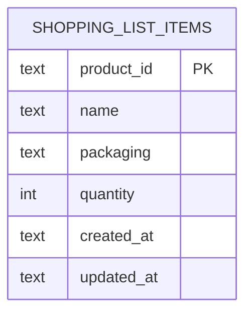

# Banco local da lista de compras

A lista de compras do Mercadex precisa sobreviver ao fechamento do aplicativo. O armazenamento desta sprint é um SQLite local, criado com `sqflite` no dispositivo. Não há sincronização com o PostgreSQL do backend e os registros não são separados por conta.

A sessão de login continua em memória. Depois de reiniciar o app, pode ser necessário entrar de novo para ver a aba Lista. Os itens gravados permanecem no arquivo local.

## Objetivo

Guardar os produtos que o usuário colocou na lista, com nome, embalagem e quantidade, e permitir criar, ler, atualizar e excluir esses registros.

## Banco

| Item | Valor |
| --- | --- |
| Arquivo | `mercadex.db` |
| Versão | 1 |
| Tabela | `shopping_list_items` |
| Criação | `openDatabase`, com `onCreate` na primeira abertura |

A conexão fica em `ShoppingListDatabase` e é reutilizada. Uma falha de leitura ou gravação não apaga o arquivo.

## Entidade



## Dicionário de dados

| Coluna | Tipo | Obrigatória | Descrição |
| --- | --- | --- | --- |
| `product_id` | TEXT | sim | Identificador estável do produto. Chave primária. |
| `name` | TEXT | sim | Nome exibido na lista. |
| `packaging` | TEXT | sim | Embalagem exibida na lista. |
| `quantity` | INTEGER | sim | Quantidade maior que zero. |
| `created_at` | TEXT | sim | Criação em ISO 8601, UTC, com 6 dígitos de fração. |
| `updated_at` | TEXT | sim | Última alteração, no mesmo formato. |

## Constraints

- `product_id` é chave primária, então o mesmo produto não gera duas linhas.
- `name`, `packaging`, `quantity`, `created_at` e `updated_at` são `NOT NULL`.
- `CHECK (quantity > 0)` impede quantidade zero ou negativa. Quantidade 1 que diminui exclui a linha em vez de gravar zero.

## Schema

```sql
CREATE TABLE shopping_list_items (
    product_id TEXT PRIMARY KEY,
    name TEXT NOT NULL,
    packaging TEXT NOT NULL,
    quantity INTEGER NOT NULL CHECK (quantity > 0),
    created_at TEXT NOT NULL,
    updated_at TEXT NOT NULL
);
```

A leitura ordena por `created_at ASC, product_id ASC`.

## Decisões

- Só a lista de compras entra no SQLite. Produto, mercado e observação de preço continuam no fluxo remoto ou nos mocks.
- Não há tabela de usuários. Isolar a lista por conta ficaria para uma entrega posterior.
- As datas usam texto ISO 8601 em UTC, com largura fixa, para a ordenação lexicográfica coincidir com a ordem cronológica.
- O PostgreSQL e o Prisma não foram alterados.
